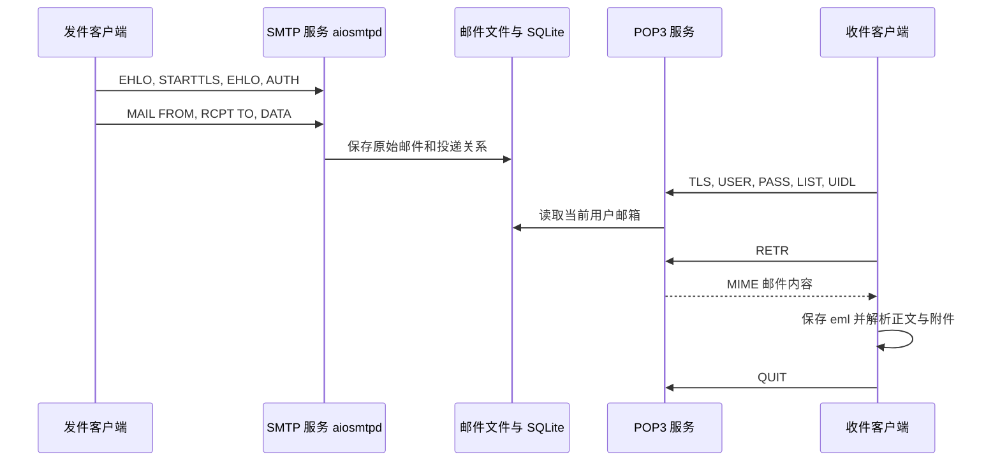

# 基础功能设计说明

## 系统结构

SMTP 和 POP3 共享 `Storage`，客户端只经网络协议访问服务器。服务端按 SMTP 信封收件人投递，只接受已注册的本地收件人；信封发件人必须与认证账号一致。此系统不是公网邮件中继，也不支持向外部邮箱投递。

SQLite 包含用户密码哈希、邮件元数据（信封发件人、接收 UTC 时间、路径、大小）和按收件人分开的投递记录。原始 MIME 邮件保存在服务器文件目录；客户端独立保存 `.eml`。同一邮件可以投递给多个用户，每个投递有稳定 UID。每个操作独立使用数据库连接和事务；删除只移除投递记录，当前版本不自动清理失去所有投递的原始邮件文件。

## MIME

发送时 `email.message.EmailMessage` 构造纯文本正文；如提供 HTML，则生成 `multipart/alternative`；添加附件后形成含附件的多部分结构。收件后先按 UID 保存完整原始邮件，再使用 `email` 解析主题、正文和附件；附件名经过路径和非法字符处理，避免任意路径写入及覆盖已有文件。展示程序不渲染 HTML。

## 认证和传输

SMTP 支持 AUTH PLAIN 和 LOGIN，由 aiosmtpd 调用本项目的账号验证逻辑；POP3 使用 USER/PASS。密码以 PBKDF2-HMAC-SHA256 加随机盐存储。TLS 模式下 SMTP 强制 STARTTLS 后认证，POP3 从连接建立开始使用 TLS；客户端信任所指定证书并验证主机名或 IP。明文模式仅用于对照，不应使用真实密码。

## POP3 会话与并发

支持 USER、PASS、STAT、LIST、UIDL、RETR、DELE、RSET、NOOP、QUIT。读取命令按 CRLF 分帧；RETR 对点开头的行进行点转义；删除先做会话标记，正常 QUIT 时提交，断开时放弃。每个邮箱同一时间只允许一个 POP3 会话，避免并发删除冲突；不同邮箱可并发。SMTP 使用 aiosmtpd，POP3 使用线程服务器。实现范围面向课程验收，不包含完整 RFC 扩展、IMAP 或外部域名投递。可选的本地垃圾邮件过滤及训练方式见[垃圾邮件过滤扩展](垃圾邮件过滤.md)。

## Web 客户端扩展

`mailproject.web` 是独立启动的 Flask 客户端，通过现有 `send`、`connect_pop`、`fetch_messages` 连接 SMTP/POP3，复用过滤器，不修改协议服务或服务器数据库。依赖放在 `requirements-web.txt`，页面与样式分别位于 `templates` 和 `static`。默认下载到独立的 `web-downloads`，按认证账号隔离目录；同一进程内的同一账号收信使用互斥锁。

登录通过 POP3 验证后立即结束协议会话。浏览器只持有签名会话标识和表单令牌，账号密码在服务内存中保存最多 30 分钟（到期后的请求触发清理），退出或重启服务后失效。所有修改操作使用 POST 并验证表单令牌；邮件正文和主题经模板转义，附件按下载响应返回，避免在页面中执行邮件内容。详情和附件仅从当前账号目录查找，不接受任意文件路径。

网页仅绑定本机，适用于课程演示；不提供公网部署、服务器邮件删除、已读状态和已发送箱。操作流程与限制见 [Web 邮件管理界面](Web邮件管理.md)。

## 提交与演示

客户端可通过 `--config` 读取按命令分组的 JSON 参数，命令行显式参数优先，密码仍交互输入。服务器列表读取邮件以展示主题和发件人；本地 `local-list`、`spam-list` 与 `view --number` 共用按文件名排序的编号，编号不跨邮件增删保持稳定，也不等于 POP3 服务器编号。具体操作见用户手册。

测试程序、手册和报告为后续课程报告提供素材。现场还需要按照手册录制或截取自己的 Wireshark 明文/TLS 对照、模拟代理被拒绝的结果，并结合实际环境完成最终报告。标准库客户端封装了 Socket 通信；是否需要手写客户端协议应由助教确认。
